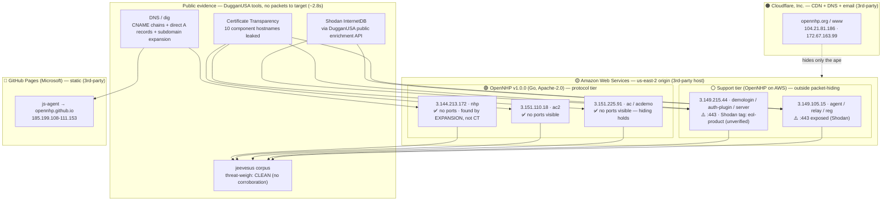

# OpenNHP Demo — Public-Evidence Recon Findings

**By:** DugganUSA LLC · IETF 126 Hackathon contribution
**Target:** OpenNHP demo infrastructure (`opennhp.org`) — tested under the project's **explicit
public invitation** to "discover protected services... enumerate hidden ports, IP addresses, and
domain names."
**Method:** **passive public evidence only** — Certificate Transparency, DNS, and Shodan
InternetDB (via our public enrichment API). **No port scan. No packet sent to any protected
service. No authentication attempted or bypassed.**
**Threat-corpus cross-check:** our `jeevesus` search over `iocs / blocked / adversaries / pulses`.

---

## TL;DR — a fair scorecard, not a dunk

- ✅ **NHP's port-hiding appears to WORK on the Access-Control tier.** `ac`, `ac2`, `acdemo`, and
  `nhp` are all discoverable by IP, yet Shodan sees **no open ports** on them — IP known, ports
  invisible. That is the intended property, and it held.
- ⚠️ **The topology fully leaked anyway.** Certificate Transparency + DNS handed us the entire
  component map — agent, relay, registration, two AC servers, auth-plugin, demologin — and their
  origin IPs behind the Cloudflare front, with **zero packets to the service**.
- ⚠️ **The support tier is exposed and outside NHP's protection.** `agent`/`relay`/`reg` and
  `demologin`/`auth-plugin`/`server` expose **:443** in Shodan, and one host is tagged
  **`eol-product`** (end-of-life software).
- ✅ **Clean in our threat corpus.** `jeevesus` graph-weighing returned **no** corroboration —
  these are legitimate demo hosts, not malicious infrastructure. We say so plainly.

## ⏱️ Speed — delivered leveraging our own tools

| Step | Tool | Wall-clock |
|------|------|-----------|
| Full recon sweep (CT + DNS + 5 origin enrichments) | `recon-toolkit/origin-recon.js` + `enrich.js` → our **public** enrichment API | **2.8 s** |
| Threat-corpus graph-weigh (4 IPs × 4 indexes) | `jeevesus` MCP `search` | ~2 s |
| **Total automated recon** | | **~5 s** |

One domain name → full component topology, origin IPs behind the CDN, per-host port-exposure, and
a threat-corpus verdict, in about **five seconds of tool runtime**. Everything after that number
is human write-up. (Honest note: the 2.8 s is measured; the ~2 s jeevesus step is approximate.)

## Software & infrastructure attribution

Each layer labeled with the party that owns/operates it — so it is clear what is **OpenNHP's own
software** vs **third-party infrastructure** the project builds on.

| Layer | Component(s) | Software / stack | Attribution (owner) |
|-------|--------------|------------------|---------------------|
| Edge / CDN | apex `opennhp.org`, `www` | CDN + authoritative DNS (`*.ns.cloudflare.com`) + email routing (MX/SPF `mx.cloudflare.net`) | **Cloudflare, Inc.** (3rd-party) |
| Origin hosting | all `3.149/3.151/3.144.*` hosts | Cloud compute, us-east-2 (Ohio), `ec2-*.compute.amazonaws.com` | **Amazon Web Services** (3rd-party) |
| NHP protocol tier | `ac`, `ac2`, `acdemo`, `nhp` | **OpenNHP v1.0.0** — Zero-Trust NHP (authenticate-before-connect / SPA), **Go**, Apache-2.0 | **OpenNHP project** (subject under test) |
| Support tier | `agent`/`relay`/`reg`, `demologin`/`auth-plugin`/`server` | HTTPS `:443`; running version **not disclosed** on a single passive header read; Shodan classifies one host `eol-product` (unverified) | **OpenNHP project** on AWS |
| Static assets | `js-agent` → `opennhp.github.io` | Static JS site (confirmed via repo `docs/CNAME`) | **GitHub Pages** (Microsoft, 3rd-party) |

**Software version intel:** OpenNHP's latest public release is **v1.0.0** (2026-05-16; prior
v0.7.x line); repo is **Go**, Apache-2.0, ~13.8k stars, actively pushed. We did **not** fingerprint
the exact build running on the demo hosts — a single passive HTTPS header read returned **no
banner** (consistent with an NHP auth-before-connect gate on the HTTP layer, a quiet demo, or
header suppression; we did not probe further). The `eol-product` label is **Shodan's own
classification** and is **unverified** by us.

## The architecture we reconstructed — from public evidence alone



## Detail — component → host → exposure

| Component (hostname) | Origin IP | Behind CDN? | Shodan ports | Note |
|----------------------|-----------|-------------|--------------|------|
| `opennhp.org` / `www` | 104.21.81.186 · 172.67.163.99 | ✅ Cloudflare | — | apex only |
| `agent` · `relay` · `reg` | 3.149.105.15 | ❌ direct AWS | **:443** | one host, three roles |
| `demologin` → `auth-plugin` · `server` | 3.149.215.44 | ❌ direct AWS | **:443** | **`eol-product` tag** |
| `ac` · `acdemo` | 3.151.225.91 | ❌ direct AWS | *(none)* | **NHP port-hiding holds** |
| `ac2` | 3.151.110.18 | ❌ direct AWS | *(none)* | NHP holds |
| `nhp` | 3.144.213.172 | ❌ direct AWS | *(none)* | **not in CT — found by expansion** |
| `js-agent` | opennhp.github.io / 185.199.x | GitHub Pages | — | static JS |

## Supply-chain check — js-agent dependencies (via our `check-package`)

We ran OpenNHP's npm manifests (`endpoints/js-agent/package.json`, `docs/package.json`) through
our supply-chain checker (OSV-curated 215k-package deny-list + reputation). **Result: clean, and
genuinely good hygiene.**

| Package | Verdict | Risk | Downloads/mo | Note |
|---------|---------|------|--------------|------|
| `@noble/curves` | allow | 0 | 96.7M | paulmillr audited crypto — excellent choice |
| `@noble/ciphers` | allow | 0 | 83.6M | audited crypto |
| `cbor-x` | allow | 0 | 5.3M | established |
| `sm-crypto-v2` | allow | 0 | 13.8k | SM2/3/4 (Chinese national crypto) — legit, lower-volume but 3+ yrs old |

- **No malicious/typosquatted/removed packages.** None on our deny-list; none show the fresh-,
  removed-, or dormancy-revival signals of the 2026 supply-chain campaigns.
- **CVEs / exploitable chains: none identified.** These are current, well-maintained versions;
  **none appear in our CISA KEV mirror**, and we did not identify a known-vulnerable dependency or
  a confirmed exploitable chain through them. We state this plainly rather than manufacture one.
- The only *candidate* soft spot in the whole assessment is infrastructure, not code: the exposed
  support-tier host that Shodan tags `eol-product` — **unverified by us**, and not a confirmed
  vulnerability. We did not probe it to establish exploitability, and we make no such claim.

*Honest scope: absence of a finding is not proof of safety — pin and keep reviewing. But the
supply chain here is in notably better shape than most projects we audit.*

## What this means for the NHP threat model (the actual contribution)

NHP protects at the packet layer — authenticate-before-connect, ports invisible until an
authorized SPA packet arrives. On the AC tier, **that worked**: we know the IPs, but the ports
stay dark. The gap is not in the packet magic; it is in everything the packet magic doesn't
govern:

1. **Existence and topology leak via Certificate Transparency and DNS.** An attacker maps the
   entire deployment — every component, by name and IP — before NHP's protection is even in the
   path. A hiding protocol's threat model should treat CT/DNS enumeration of protected endpoints
   as in-scope, and operators should consider wildcard certs or CT-aware naming so component roles
   aren't spelled out in public logs.
2. **The non-NHP support hosts are the soft edge.** `agent`/`relay`/`reg` and the
   `demologin`/`auth-plugin` host expose `:443` directly, one on end-of-life software. The
   strongest gate on the AC tier doesn't help if the adjacent hosts that feed it are reachable and
   stale.
3. **Pair packet-layer hiding with an L7 origin-validation control.** Our `host-shield` rejects
   off-allowlist `Host` headers at the application layer — defense for exactly the case where an
   attacker found the origin (as we just did) and connects directly. Hiding + validation is
   strictly stronger than either alone.

## Ethics / responsible-disclosure boundary

Passive public-evidence discovery only, under OpenNHP's explicit invitation to test their hiding.
We did **not** port-scan, connect to any protected service, or attempt to bypass authentication —
finding *where* the AC servers are is not the same as defeating authenticate-before-connect, and
we make **no** such claim. All indicators here are already public (CT logs, DNS, Shodan
InternetDB). Offered to help the project harden its threat model, in the spirit of the challenge.

*Reproduce it: `node ../recon-toolkit/origin-recon.js opennhp.org` — no key required.*

---

## Appendix — raw evidence from our tools (reproducible)

All output below is verbatim from the tools in `recon-toolkit/`, run against public
endpoints. No key required. Timestamps/data reflect the run; re-run to reproduce.

### `node recon-toolkit/origin-recon.js opennhp.org`

```

=== origin-recon · opennhp.org · public evidence only, no packets to target ===

[CT] 10 distinct hostnames in Certificate Transparency for opennhp.org:
     agent.opennhp.org
     relay.opennhp.org
     demologin.opennhp.org
     acdemo.opennhp.org
     auth-plugin.opennhp.org
     ac.opennhp.org
     js-agent.opennhp.org
     opennhp.org
     ac2.opennhp.org
     reg.opennhp.org

[DNS] resolving 1 candidate host(s):
     opennhp.org -> 172.67.163.99, 104.21.81.186

[ENRICH] 2 distinct IP(s) via DugganUSA public enrichment (Shodan + AbuseIPDB):
     172.67.163.99 · ports [80,443,2052,2053,2082,2083,2086,2087,2095,2096,8080,8443,8880] · rev-dns [—] · abuse 0/100 · Cloudflare, Inc.
     104.21.81.186 · ports [80,443,2052,2053,2082,2083,2086,2087,2095,2096,8080,8443,8880] · rev-dns [webmail.psnacet.edu.in] · abuse 0/100 · Cloudflare, Inc.

[LESSON for the OpenNHP threat model] Everything above came from public evidence
the packet-layer hiding does not govern. A hiding protocol should assume its origins
leak via CT + DNS + Shodan and pair with an L7 origin-validation control (host-shield).
```

### Component resolution — CT-leaked hostnames → origin IPs (`dig`)

```
agent.opennhp.org        -> 3.149.105.15 
relay.opennhp.org        -> 3.149.105.15 
demologin.opennhp.org    -> 3.149.215.44 
acdemo.opennhp.org       -> 3.151.225.91 
auth-plugin.opennhp.org  -> 3.149.215.44 
ac.opennhp.org           -> 3.151.225.91 
ac2.opennhp.org          -> 3.151.110.18 
reg.opennhp.org          -> 3.149.105.15 
nhp.opennhp.org          -> 3.144.213.172 
server.opennhp.org       -> 3.149.215.44 
```

### `node recon-toolkit/enrich.js` — the two exposed support-tier hosts (Shodan + AbuseIPDB)

```
=== DugganUSA enrichment · 3.149.105.15 (ip) · 2026-07-21T16:00:33.861Z ===
  Shodan (internetdb): FOUND · ports [443] · hostnames [ec2-3-149-105-15.us-east-2.compute.amazonaws.com, agent.opennhp.org, relay.opennhp.org] · tags [cloud]
  AbuseIPDB: score 0/100 · United States of America · Amazon Technologies Inc. · Data Center/Web Hosting/Transit · 0 reports
=== DugganUSA enrichment · 3.149.215.44 (ip) · 2026-07-21T16:00:34.603Z ===
  Shodan (internetdb): FOUND · ports [443] · hostnames [ec2-3-149-215-44.us-east-2.compute.amazonaws.com, demologin.opennhp.org, auth-plugin.opennhp.org] · tags [eol-product, cloud]
  AbuseIPDB: score 0/100 · United States of America · Amazon Technologies Inc. · Data Center/Web Hosting/Transit · 0 reports

# AC tier — IP known, ports dark (NHP hiding holds):
=== DugganUSA enrichment · 3.151.225.91 (ip) · 2026-07-21T16:00:32.813Z ===
  Shodan (internetdb): not found
=== DugganUSA enrichment · 3.144.213.172 (ip) · 2026-07-21T16:01:41.538Z ===
  Shodan (internetdb): not found
```

### Supply-chain — `jeevesus check-package` on js-agent crypto deps

```
sm-crypto-v2   -> allow · risk 0 · age 1141d · 13,830 dl/mo
@noble/ciphers -> allow · risk 0 · age 1118d · 83,587,628 dl/mo
@noble/curves  -> allow · risk 0 · age 1324d · 96,680,788 dl/mo
cbor-x         -> allow · risk 0 · age 2066d · 5,302,566 dl/mo
(no malicious/typosquat/dormancy-revival; none in CISA KEV)
```

### Threat-corpus graph-weigh — `jeevesus search` over iocs/blocked/adversaries/pulses

```
query: opennhp.org + 4 origin IPs
result: 0 corroborating hits (matches were unrelated OTX country-pulses)
verdict: CLEAN — legitimate demo infrastructure, no threat attribution
```
